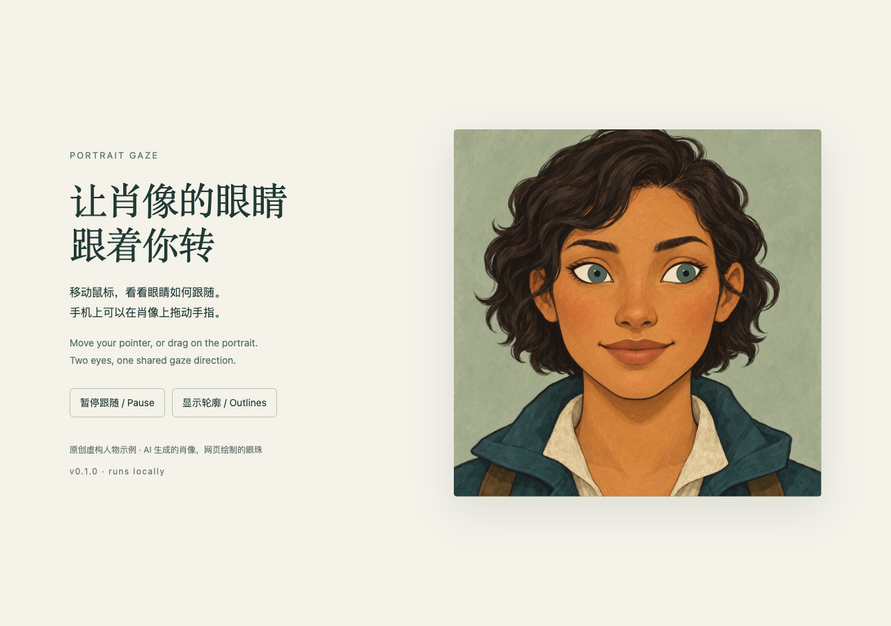

# Portrait Gaze · 肖像眼神跟随

让 AI 画一张眼白留空的人物肖像，量出眼白轮廓，再补入会跟随鼠标或手指的眼珠。最后得到一个能在浏览器里直接打开的 HTML 文件。

这是一个可安装的 **Agent Skill**，也包含可以单独使用的 Python 脚本和 JavaScript。它把图像生成、轮廓核对和网页制作接成一个流程；图片生成使用你已有的 AI 图像工具。



## 先看示例

下载仓库后，直接打开 [examples/portrait-gaze-demo.html](examples/portrait-gaze-demo.html)。不需要服务器或 API key。移动鼠标；手机上在肖像区域拖动手指。页面有暂停按钮，并遵守系统的“减少动态效果”设置。

[空白原图](examples/portrait-blank.png) → [绿色轮廓核对图](examples/outline-check.png) → [交互网页](examples/portrait-gaze-demo.html)

示例为新生成的虚构人物，素材说明见 [ASSETS.md](ASSETS.md)。在 GitHub 文件页需要先下载 HTML；GitHub 本身不会在代码预览中运行它。

## 安装为 Skill

把仓库内的 `portrait-gaze/` **整个文件夹**复制到你的 Agent 的 skills 目录。不要只复制 `SKILL.md`，脚本与网页模板也需要一起保留。

常见位置包括 `~/.agents/skills/`、`~/.claude/skills/`、`~/.codex/skills/`，具体以所用工具的技能发现规则为准。这个包不依赖某个厂商的私有 API。

然后对支持技能的 Agent 说：

> 使用 portrait-gaze，把这张人物参考图做成眼神能跟随鼠标的肖像，先给我看眼白轮廓，再生成网页。

需要能查看图片、执行 Python 的 Agent。若要从零生成或修改肖像，还需可用的图像生成工具；没有时，可以提供已经准备好的空白眼白图。

## 不用 Agent，也能运行示例

需要 Python 3.10+。在仓库根目录执行：

```sh
python3 -m venv .venv
.venv/bin/python -m pip install -r portrait-gaze/requirements.txt
.venv/bin/python portrait-gaze/scripts/measure.py examples/portrait-blank.png examples/regions.json --out output/eyes.json --preview output/outline-check.png
```

打开 `output/outline-check.png`，确认绿色轮廓贴合两个眼白，再执行：

```sh
.venv/bin/python portrait-gaze/scripts/build.py examples/portrait-blank.png output/eyes.json --out output/portrait.html --approve-outline
```

打开 `output/portrait.html` 即可。Windows 请把 `.venv/bin/python` 换成 `.venv\Scripts\python.exe`。命令默认拒绝覆盖已有输出；重做自己的中间文件时可加 `--force`。

## 换成自己的肖像

1. 生成正面肖像，留下完整、浅色、没有瞳孔和虹膜的眼白。
2. 按原图像素尺寸，在每个眼白里面选一个点，并提供包住眼睛的矩形框。格式参照 [regions.json](examples/regions.json)。Agent 可以通过看图完成这一步，脚本不自动识别人脸。
3. 填写虹膜颜色、半径等参数，运行测量并检查绿线，然后生成网页。

真实人物的眼睛颜色和大小应依据参考图；看不清时不要把选定的颜色说成真实还原。网页绘制的是简化的虹膜和瞳孔。如何准备图片和调整参数见 [输入说明](portrait-gaze/references/portrait-input.md)，接入现有网页见 [集成说明](portrait-gaze/references/integration.md)。

## 工作方式与边界

AI 负责绘制肖像、定位眼睛的大致区域及检查结果。Python 从指定种子点测量相连的浅色像素并提取边界。网页用 SVG 裁剪限制眼珠可见范围，再根据指针位置同步移动两只眼睛。

适合轮廓清楚的插画；照片纹理、已有瞳孔、遮挡、断开的眼睑或大角度侧脸可能无法测量。当前每张图支持一张脸、两只眼睛。默认测量失败时会报错，不会自动猜一条轮廓。生成后的网页离线运行，不上传图片、不调用摄像头、不加载统计脚本。调用图像生成工具时，其费用和数据处理规则由该工具决定。

## 测试

```sh
.venv/bin/python -m unittest discover -s tests -v
node --test tests/gaze.test.cjs
```

可选浏览器测试（需要 Node.js 20+；开发依赖，不是使用 Skill 的前提）：

```sh
npm ci
npx playwright install chromium
npm run test:browser
```

## English

An Agent Skill for creating pointer-following portrait eyes. Generate a portrait with blank sclera, supply rough eye boxes and seeds, measure and visually review the boundaries, then build a self-contained HTML page. Mouse and touch input are supported. Python 3.10+ and Pillow are needed for the build; the finished page uses plain JavaScript and no network services. Image generation is supplied by your host tool, not bundled here.

## License

MIT. See [LICENSE](LICENSE). The demo artwork's provenance and third-party dependency notices are documented in [ASSETS.md](ASSETS.md).
